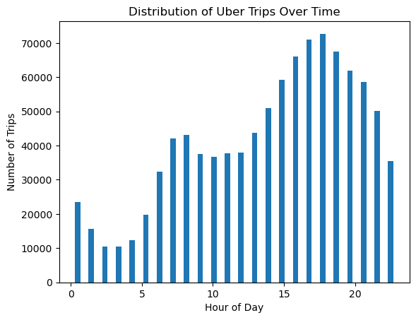
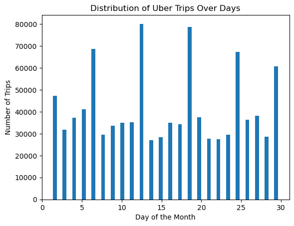
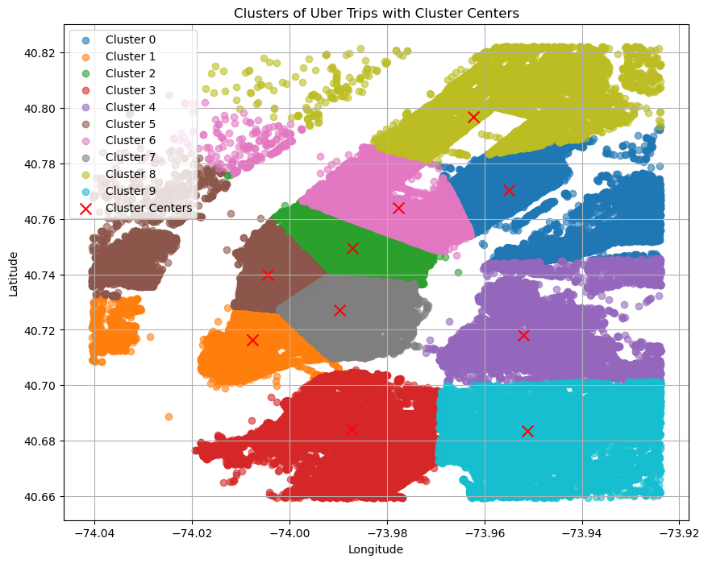
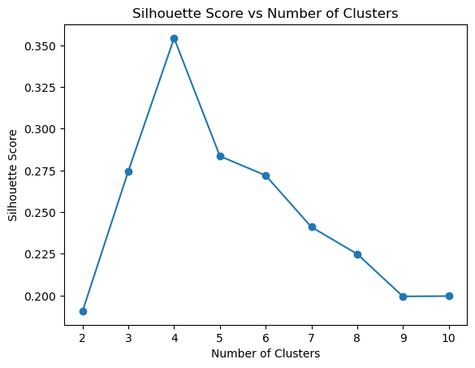

# Uber Trip Clustering


## Project Overview

This project explores Uber trip patterns using unsupervised
machine learning techniques. The objective is to identify
temporal and geographical patterns in Uber trip data through
exploratory data analysis and clustering algorithms.

## Objectives

- Analyze Uber trip distributions across time and location.
- Perform data cleaning and feature engineering.
- Explore different clustering algorithms.
- Evaluate clustering performance using the Silhouette Score.
- Visualize clusters and trip patterns.

## Dataset

The dataset contains the following features:

| Feature | Description |
|---------|-------------|
| Date/Time | Trip date and time |
| Lat | Latitude |
| Lon | Longitude |
| Base | Uber base identifier |

Additional temporal features are extracted from the timestamp.

## Methodology

1. Exploratory Data Analysis (EDA)
2. Missing value analysis
3. Feature engineering
4. Duplicate removal
5. One-Hot Encoding
6. Outlier removal using IQR
7. Feature standardization using StandardScaler
8. Clustering and evaluation

## Clustering Algorithms

- K-Means
- DBSCAN
- Agglomerative Hierarchical Clustering
- Gaussian Mixture Model (GMM)
- Mean Shift

## Evaluation

The Silhouette Score is used to evaluate cluster quality.

The K-Means experiment evaluates cluster counts from 2 to 10,
with the highest recorded Silhouette Score occurring at k = 4.

Different feature subsets are used across experiments.
Therefore, the results should not be interpreted as a
controlled comparison of all algorithms.

## Technologies and Libraries

- Python
- Jupyter Notebook
- NumPy
- Pandas
- Matplotlib
- Seaborn
- Scikit-learn

## Project Structure

```text
uber-trip-clustering/
├── data/
│   └── uber-data2.csv
├── notebooks/
│   └── uber-trips-clustering-final.ipynb
└── README.md
```

## Results and Visualizations

### 1. Hourly Trip Distribution

Distribution of Uber trips across different hours of the day.



### 2. Daily Trip Distribution

Distribution of Uber trips across days of the month.



### 3. K-Means Clustering

Geographical clustering of Uber trips using latitude and longitude
with 10 clusters and their corresponding cluster centers.



### 4. Silhouette Score Analysis

Evaluation of K-Means clustering for different numbers of clusters
using the Silhouette Score.



## Experimental Results

Clustering performance was evaluated using the Silhouette Score.

| Algorithm | Configuration | Silhouette Score |
|-----------|---------------|-----------------:|
| K-Means | k = 4 | Not explicitly reported |
| DBSCAN | eps = 2.5, min_samples = 6 | 0.3212 |
| DBSCAN (Tuned) | eps = 2.2, min_samples = 4 | 0.4108 |
| Hierarchical (Ward) | k = 4 | 0.4108 |
| Hierarchical (Average) | k = 4 | 0.4108 |
| Gaussian Mixture Model | n_components = 4 | 0.4108 |
| Mean Shift | bandwidth = 2.5 | 0.4108 |
| Mean Shift (Grid Search) | bandwidth = 2.0 | 0.3151 |

### Key Findings

- K-Means selected four clusters based on Silhouette analysis.
- DBSCAN parameter tuning increased the recorded Silhouette
  Score from 0.3212 to 0.4108.
- Several clustering configurations produced identical
  recorded Silhouette Scores.

### Experimental Limitations

- Different feature subsets were used across experiments.
- Identical scores require further validation.
- DBSCAN noise handling requires further investigation.
- Mean Shift hyperparameter optimization requires revision.
- Results represent saved notebook outputs rather than
  independently reproduced experiments.
- A controlled comparison is required before identifying
  the best-performing algorithm.


## Future Improvements

- Standardize feature selection across clustering algorithms.
- Improve hyperparameter optimization.
- Evaluate clustering stability.
- Improve geographical cluster visualizations.
- Develop an interactive visualization dashboard.
